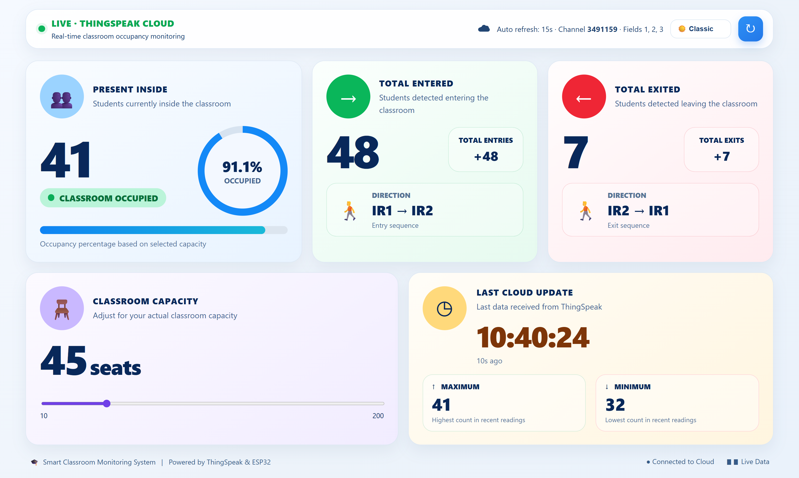
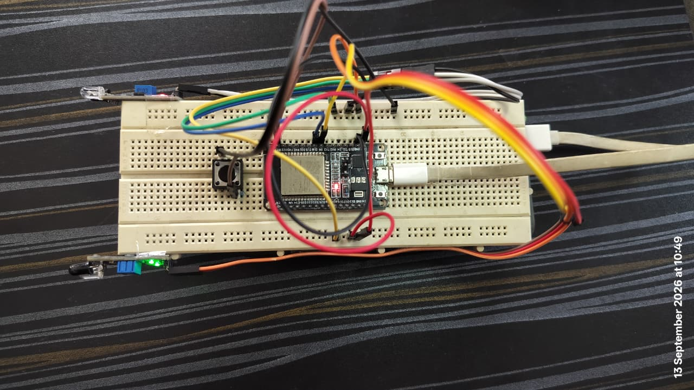
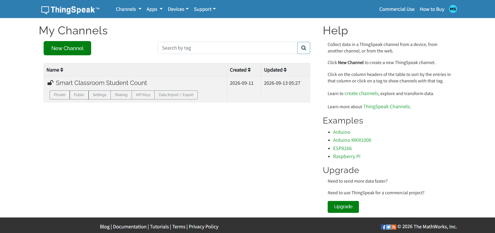

# Smart Classroom Occupancy Monitoring System

A smart classroom occupancy monitoring system using an ESP32, two IR sensors, ThingSpeak Cloud, and a web-based dashboard with role-based login.

> **Project Type:** Academic Mini Project
> **Controller:** ESP32
> **Cloud Platform:** ThingSpeak
> **Dashboard:** HTML, CSS and JavaScript

---

## 🚀 Live Dashboard

👉 **[Open Live Dashboard](https://shaikmuzahidbasha-art.github.io/smart-classroom-monitor/)**

The dashboard asks for a login:

| Role | Username | Password |
|---|---|---|
| Admin | `admin` | `Admin@123` |
| Display | `display` | `Display@123` |



---

## 1. Project Overview

The system automatically monitors the number of students inside a classroom. Two IR sensors are placed at the entrance, and the ESP32 finds the direction of movement from the order in which the sensors are triggered.

| Movement | Sensor sequence | Effect |
|---|---|---|
| Entry | IR1 → IR2 | Present Inside +1, Total Entered +1 |
| Exit | IR2 → IR1 | Present Inside −1, Total Exited +1 |

The ESP32 keeps three values: **Present Inside**, **Total Entered** and **Total Exited**.
They are saved in the ESP32's non-volatile memory (`Preferences` library) and uploaded to ThingSpeak Cloud when Wi-Fi is available. The web dashboard reads the ThingSpeak channel and displays the data.

```text
Present Inside = Total Entered - Total Exited
```

---

## 2. System Architecture

```text
IR1 Sensor ─┐
            ├─► ESP32 ──► Entry / Exit Detection ──► Occupancy Counters
IR2 Sensor ─┘                                              │
                                              ┌────────────┴───────────┐
                                              ▼                        ▼
                                   Preferences (ESP32 NVS)        Wi-Fi
                                                                       │
                                                                       ▼
                                                              ThingSpeak Cloud
                                                                       │
                                                                       ▼
                                                  Web Dashboard (Admin / Display login)
```

---

## 3. Hardware

- ESP32 development board
- Two IR sensors
- Push button for clearing the counters
- Breadboard, jumper wires, USB cable

| Component | ESP32 GPIO |
|---|---:|
| IR Sensor 1 | GPIO 5 |
| IR Sensor 2 | GPIO 18 |
| Clear Button | GPIO 23 (to GND, `INPUT_PULLUP`) |



---

## 4. ESP32 Features

1. Reads both IR sensors and detects the direction of movement.
2. Updates Present Inside, Total Entered and Total Exited.
3. **Empty-room protection:** an exit detected when the room is empty is ignored (`>>> EXIT IGNORED - ROOM EMPTY <<<`), so the count never goes negative.
4. **Reset button:** pressing the button on GPIO 23 clears all three counters, and the zero values are also saved.
5. **Persistent storage:** counters are saved to NVS (namespace `classroom`: `present`, `entered`, `exited`) after every valid event and restored after a restart or power loss.
6. Connects to Wi-Fi and uploads to ThingSpeak every **15 seconds**.
7. Prints status on the Serial Monitor (baud rate **115200**).

### If Wi-Fi is lost
Counting continues and is saved locally. ThingSpeak cannot receive updates during the outage. When Wi-Fi returns, the latest counter values are uploaded. The firmware keeps the latest state only, not a queue of every missed update.

### If power is lost
The saved counters are loaded again at start-up, so the previous values are restored.

### ESP32 storage vs ThingSpeak storage
ESP32 NVS holds the live counter state. ThingSpeak keeps the uploaded history. ThingSpeak data does not overwrite the ESP32's local counters.

---

## 5. ThingSpeak Cloud

| ThingSpeak Field | Data |
|---|---|
| Field 1 | Present Inside |
| Field 2 | Total Entered |
| Field 3 | Total Exited |

A successful upload prints `ThingSpeak Update Successful` on the Serial Monitor.



---

## 6. Web Dashboard

The dashboard (`index.html`) is a single file with HTML, CSS and JavaScript. It reads the public ThingSpeak channel data and needs no backend. It refreshes automatically every 15 seconds.

**Displays**
- Present Inside, Total Entered, Total Exited
- Classroom capacity and occupancy percentage
- Classroom status and over-capacity alert
- Latest movement direction
- Last cloud update, minimum and maximum occupancy
- Responsive layout for desktop, tablet and mobile

```text
Occupancy Percentage = (Present Inside / Classroom Capacity) × 100
```

### Login and roles
| Role | Can do |
|---|---|
| **Admin** | View the dashboard and set the classroom capacity |
| **Display** | View the dashboard only (capacity slider is locked) |

Passwords are stored as SHA-256 hashes, not plain text. This is basic role-based access for a demonstration. It is not a replacement for server-side authentication, because the page runs entirely in the browser.

The capacity value is saved in the browser it was set in.

### Themes
The dashboard has five themes, including a **true dark theme** (near-black background). The screenshots show normal operation, empty classroom, capacity alert and mobile view.

---

## 7. Data Flow

```text
Student passes the door
        ↓
IR sensors triggered in sequence
        ↓
ESP32 identifies entry or exit
        ↓
Counters updated and saved to NVS
        ↓
Values uploaded to ThingSpeak (every 15 s, if Wi-Fi is available)
        ↓
Dashboard requests the channel data
        ↓
JavaScript updates the cards, charts and status
```

---

## 8. Testing

**Hardware:** IR sensors, entry detection, exit detection, direction detection, counters, empty-room protection, reset button, data persistence.

**Cloud:** Wi-Fi connection and ThingSpeak uploads confirmed from the Serial Monitor and the channel view.

**Dashboard:** different occupancy values, entry and exit changes, empty classroom, capacity alert, cloud data refresh, themes, and responsive layout.

Example Serial Monitor output:

```text
SAVED DATA RESTORED

Present Inside : 4
Total Entered  : 12
Total Exited   : 8
```

---

## 9. Project Structure

```text
smart-classroom-monitor/
│
├── index.html                      (live dashboard, served by GitHub Pages)
├── Smart_Classroom_Monitoring/
│   ├── code/
│   │   ├── ESP32/
│   │   │   └── Smart_classroom_Occupancy.ino
│   │   └── Web_Dashboard/
│   │       └── index.html
│   └── images/
│       ├── hardware/
│       └── screenshots/
│           ├── serial_monitor/
│           ├── thingspeak_cloud/
│           └── web_dashboard/
├── .gitignore
└── README.md
```

---

## 10. How to Run

### ESP32
1. Install Arduino IDE and the ESP32 board support package.
2. Open `Smart_Classroom_Monitoring/code/ESP32/Smart_classroom_Occupancy.ino`.
3. Select the ESP32 board and COM port.
4. Enter your own Wi-Fi and ThingSpeak details locally (see Security below).
5. Upload, open the Serial Monitor at **115200** baud, and test an entry and an exit.

### Dashboard
Open the live link above, or open `index.html` in a modern browser (Chrome recommended).

---

## 11. Security and Credentials

Never commit these to the public repository:

- Wi-Fi password
- ThingSpeak Write API Key
- ThingSpeak Read API Key (if the channel is private)
- Any private tokens

Use placeholders in the shared code:

```cpp
const char* ssid = "YOUR_WIFI_NAME";
const char* password = "YOUR_WIFI_PASSWORD";
```

The dashboard login accounts above are demo accounts for this academic project.

---

## 12. Technologies Used

| Technology | Purpose |
|---|---|
| ESP32 | Main IoT controller |
| IR sensors | Entry and exit detection |
| Push button | Counter reset |
| Preferences / NVS | Persistent counter storage |
| Arduino IDE, C/C++ | ESP32 firmware |
| ThingSpeak | Cloud storage and data access |
| HTML, CSS, JavaScript | Dashboard, login and visualization |
| GitHub Pages | Dashboard hosting |

---

## 13. Conclusion

The project shows a complete IoT pipeline: physical sensing with two IR sensors, direction detection and persistent storage on the ESP32, cloud storage on ThingSpeak, and a responsive web dashboard with admin and display logins for live classroom monitoring.

---

## 👥 Team Members

| Name | RRN |
|---|---|
| SHAIK MUZAHID BASHA | 230051601102 |
| SUDHARSAN S | 230051601111 |
| RAJKUMAR M P | 230051601088 |

B. S. Abdur Rahman Crescent Institute of Science and Technology, Chennai

## License

This project is intended for academic and educational purposes.
